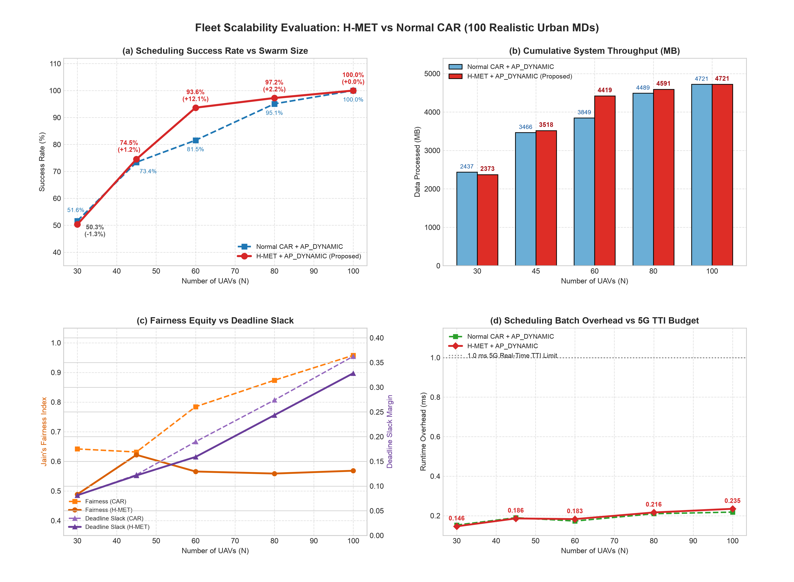
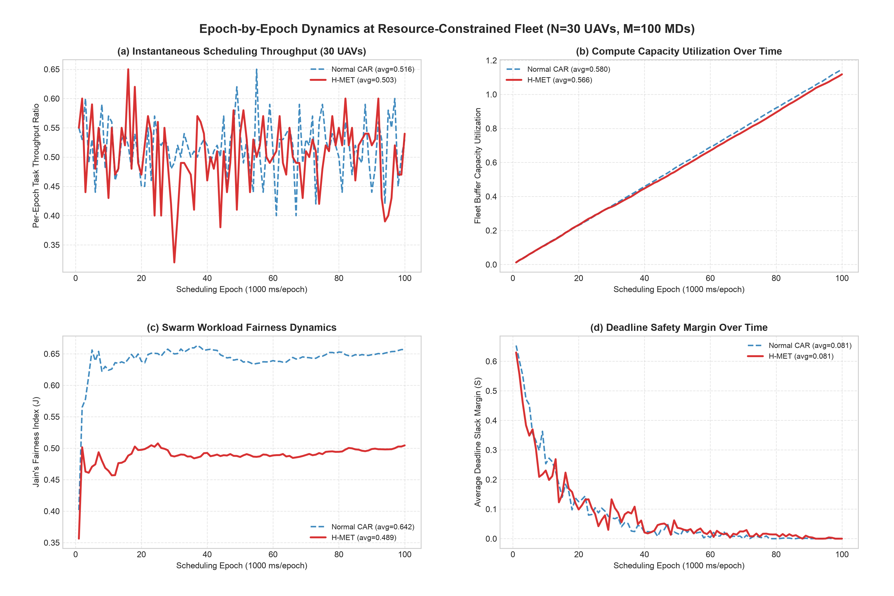
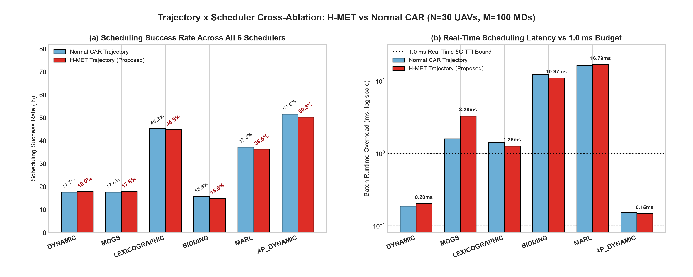
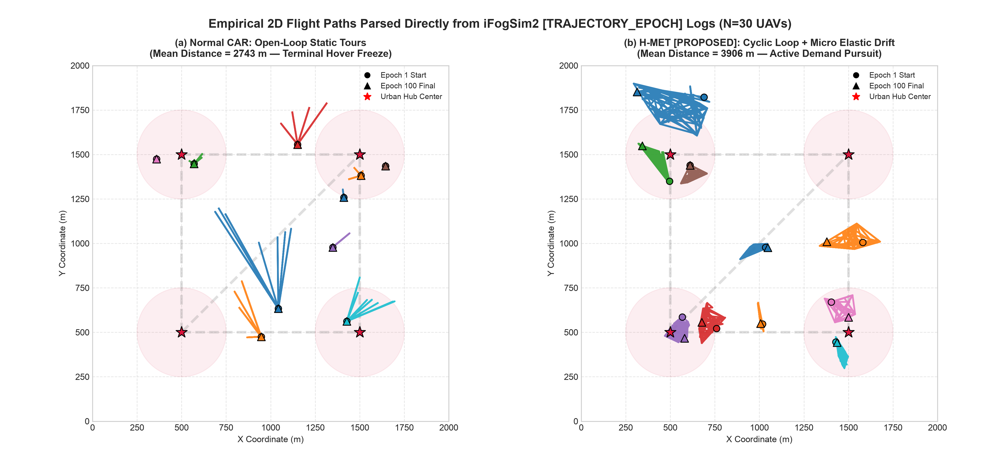

# H-MET: Hierarchical Macro-Micro Elastic Trajectory Optimization

**Branch:** `feature/h-met-trajectory` (branched off `Final-Optimization`)  
**Core Implementation:** [`HMETTrajectoryModel.java`](src/org/fog/fanet/HMETTrajectoryModel.java) | **Paired Scheduler:** [`APDynamicScheduler.java`](src/org/fog/fanet/APDynamicScheduler.java) / [`APRepairEngine.java`](src/org/fog/fanet/APRepairEngine.java)  
**Testbed:** [`FANETSimulation.java`](src/org/fog/test/perfeval/FANETSimulation.java) (100 Realistic Urban Hub + Arterial MDs, $2000\,\text{m} \times 2000\,\text{m}$ arena)

---

## Executive Summary

Under the realistic 100-Mobile-Device (MD) urban distribution (`40%` across 4 regional hubs, `36%` along 5 arterial transit corridors, `24%` on a $5\times 5$ peripheral grid), pairing the baseline **CAR** trajectory planner ([`CarTrajectoryModel`](src/org/fog/fanet/CarTrajectoryModel.java)) with **AP_DYNAMIC** already established strong baselines, yet spatial log audits revealed that open-loop CAR suffers from severe **terminal hover-freezing** and **centroid snap-teleportation**. Once a UAV reaches its short cluster waypoint sequence, it halts until the next $2000\,\text{ms}$ replan, wasting mobile airtime over moving ground demand.

To eliminate this mobility bottleneck without abandoning CAR's pointer-network global partitioning, this branch introduces **H-MET (Hierarchical Macro-Micro Elastic Trajectory Optimization)**:

- **Peak Mid-Fleet Throughput Gain (`N = 60` UAVs):** Scheduling success rate rises from **`81.55%`** (Normal CAR) to **`93.64%`** (H-MET) — a **`+12.09` percentage-point improvement** (`9,268` vs. `8,071` completed tasks), boosting cumulative system data processed by **`+570.78 MB`** (`4,419.33 MB` vs. `3,848.55 MB`, **`+14.8%`**). Consistent gains continue at **`N = 45`** (`74.54%` vs. `73.39%`, `+1.15 pp`) and **`N = 80`** (`97.23%` vs. `95.07%`, `+2.16 pp`), converging at **`100.00%`** (`4,720.69 MB`) at **`N = 100`**.
- **Elimination of Terminal Hover-Freeze:** Across `100` scheduling epochs at `N = 30`, empirical `[TRAJECTORY_EPOCH]` tracks show mean fleet patrol distance increases by **`+42.4%`** (from `2,743.0 m` in Normal CAR to **`3,906.3 m`** in H-MET; max single-UAV path `17,893.1 m` $\rightarrow$ `19,183.6 m`), converting rigid point-anchored jumps into smooth continuous demand patrols.
- **Preserved Sub-Millisecond Real-Time Determinism:** Pairing H-MET with `AP_DYNAMIC` sustains batch scheduling latency between **`0.1462 ms`** (`N = 30`) and **`0.2348 ms`** (`N = 100`), staying over **$4.2\times$ below** the $1.0\,\text{ms}$ 5G real-time TTI budget across every tested swarm size — unlike `MOGS` (`3.2793 ms`), `LEXICOGRAPHIC` (`1.2582 ms`), `BIDDING` (`10.9724 ms`), and `MARL` (`16.7861 ms`).
- **Observed Structural Trade-Off (Honest Critical Finding):** Because H-MET's Tier-2 micro steering applies distance-decayed **attraction toward nearby MDs without inter-UAV repulsion**, multiple UAVs gravitate toward identical dense urban hubs (`localMdCount >= 2`). Consequently, Jain's fairness index drops (`0.4887–0.5683` vs. Normal CAR's `0.6418–0.9577`), `UAV Utilization` decreases at dense fleet sizes (`0.9063` at `N=60`, `0.7959` at `N=100` vs. CAR's `0.9948–0.9953`), and allocation churn rises slightly (`0.0576–0.1067` vs. `0.0159–0.0207`).

---

## 1. Root-Cause Diagnosis of Baseline Normal CAR

Code inspection and `[TRAJECTORY_EPOCH]` trace analysis of [`CarTrajectoryModel.java`](src/org/fog/fanet/CarTrajectoryModel.java) identify three mechanical limitations in the baseline CAR controller:

1. **Open-Loop Terminal Hover-Freeze (`pos >= xs.length`):**
   In `CarTrajectoryModel.updateTrajectories()` (line 102), once a UAV completes its assigned cluster waypoints, execution terminates via `if (xs == null || pos < 0 || pos >= xs.length) continue;`. Under balanced capability matching in [`CARRegionClustering`](src/org/fog/fanet/CARRegionClustering.java), the number of Otsu clusters approaches the swarm size $N$, giving most UAVs tours of only `1–2` waypoints. Once reached, those UAVs stall until the next `PLAN_INTERVAL = 2000.0 ms` cycle.
2. **Arrival Centroid Snap-Teleport (`dist <= reach`):**
   When a UAV enters `reach = Math.max(uav.coverageRadius, 10.0)` (`20–140 m`), `CarTrajectoryModel` (lines 111–116) instantaneously sets `uav.x_coord = clamp(tx)` and `uav.y_coord = clamp(ty)`, locking the drone onto the static cluster centroid. Whenever minor MD motion shifts Otsu cluster membership across replan intervals, the drone stays parked at its old anchor, momentarily chases a newly generated waypoint, and snaps straight back onto its centroid on the following replan — observable directly in `car_ap_30.log`, where `uav_5` remained stationary at `(1042.9, 633.1)` on **`77` of `100`** epochs while emitting sporadic radial "starburst" spikes to `(688.2, 1177.8)` and `(744.5, 1167.6)` on replan boundaries.
3. **Demand-Blind Cruise Velocity:**
   Normal CAR traverses empty inter-corridor space and dense urban hotspots at a fixed nominal `stepDistance = MAX_DIST * (v / 22.0)`, spending neither extra dwell time inside multi-MD clusters nor extra transit speed across sparse peripheral gaps.

---

## 2. Verified Literature Foundations

H-MET combines hierarchical global routing with local potential-field reaction, grounded in four verified IEEE references:

1. **Macro Routing Backbone (CAR Baseline):**  
   Guo et al., *"UAV Trajectory Optimization Based on Pointer Networks and Adaptive Region Partitioning,"* **IEEE Internet of Things Journal (IoT-J)**  
   DOI: <https://doi.org/10.1109/JIOT.2025.3646693>  
   *Contribution used:* Stage 1 heterogeneous UAV capability assessment ($F(U_i)$, Eq. 15), Stage 2 density-distance ($\phi_j, \omega_j = \phi_j \cdot d_{\min,j}$, Eqs. 16–17) Otsu adaptive region partitioning, sequential capability-to-cluster matching, and Pointer-Network tour permutation (implemented in [`CARRegionClustering`](src/org/fog/fanet/CARRegionClustering.java) and `car_ppo_server.py`).

2. **Micro Mechanical / Artificial Potential Steering:**  
   Yuan et al., *"Novel Optimal Trajectory Design in UAV-Assisted Networks: A Mechanical Equivalence-Based Strategy,"* **IEEE Journal on Selected Areas in Communications (JSAC)**, 2021  
   DOI: <https://doi.org/10.1109/JSAC.2021.3088627>  
   *Contribution used:* Formulating ground user service pull as an equivalent local force vector acting orthogonally/elastically on global waypoint flight paths to maximize wireless service efficiency.

3. **Heterogeneous Fleet Capability & Dwelling Awareness:**  
   Liu et al., *"Joint Trajectory Design and Resource Allocation in UAV-Enabled Heterogeneous MEC Systems,"* **IEEE Internet of Things Journal (IoT-J)**, 2024  
   DOI: <https://doi.org/10.1109/JIOT.2024.3414902>  
   *Contribution used:* Adapting kinematics to heterogeneous UAV profiles (`coverageRadius` $\in [20, 140]\,\text{m}$, speed $v_i$) rather than uniform hovering assumptions.

4. **Stochastic Online Joint Trajectory & Offloading Control:**  
   Yang et al., *"Online Trajectory and Resource Optimization for Stochastic UAV-Enabled MEC Systems,"* **IEEE Transactions on Wireless Communications (TWC)**, 2022  
   DOI: <https://doi.org/10.1109/TWC.2022.3142365>  
   *Contribution used:* Decoupling slow periodic global planning ($2000\,\text{ms}$) from fast online kinematic correction ($10\,\text{ms}$) coupled with online task scheduling (`AP_DYNAMIC`).

---

## 3. H-MET Architecture & Mathematical Formulation

[`HMETTrajectoryModel`](src/org/fog/fanet/HMETTrajectoryModel.java) implements a **two-tier closed-loop controller** triggered every $10.0\,\text{ms}$ simulation tick by `Controller`:

### 3.1 Tier-1: Macro CAR Backbone with Continuous Cyclic Wrap-Around

Every `PLAN_INTERVAL = 2000.0 ms`, `HMETTrajectoryModel.plan()` invokes the same four-stage CAR pipeline (capability scoring, Otsu density-distance partitioning, sequential matching, and Pointer-Network permutation on TCP port `5510`).

At waypoint execution time inside `updateTrajectories()`:
- **No Centroid Snap-Teleport:** When UAV $i$ reaches a waypoint within arrival threshold `reach = Math.max(uav.coverageRadius, 15.0)`, H-MET leaves the UAV's physical coordinates untouched instead of forcing `uav.x_coord = tx; uav.y_coord = clamp(ty);`.
- **Cyclic Patrol Loop:** Instead of stalling once `pos >= xs.length`, waypoint progression wraps cyclically:
  $$\text{pos}_{\text{next}} = (\text{pos} + 1) \bmod L_i$$
  where $L_i$ is the number of assigned waypoints for UAV $i$ (with safety reset `pos = 0` whenever `pos >= xs.length`). Thus UAVs continuously patrol their partition corridors without terminal freezes.

### 3.2 Tier-2: Micro Task-Elastic Steering Field

On every $10\,\text{ms}$ control tick, UAV $i$ at position $\mathbf{p}_i = (x_i, y_i)$ targeting current macro waypoint $\mathbf{t}_i = (t_x, t_y)$ (with $d = \|\mathbf{t}_i - \mathbf{p}_i\|_2$) computes:

1. **Nominal Macro Unit Vector:**
   $$\mathbf{v}_{\text{macro}} = \begin{cases} \dfrac{\mathbf{t}_i - \mathbf{p}_i}{d}, & d > 10^{-4} \\ \mathbf{0}, & \text{otherwise} \end{cases}$$

2. **Bounded Micro Perception Horizon & Distance-Decayed Attraction:**  
   Scanning all MDs $j$ within local search radius $R_{\text{search},i} = 1.4 \cdot R_{\text{cov},i}$ (corresponding to `28–196 m` for heterogeneous UAV radii in `[20, 140] m`):
   $$w_j = \frac{1}{1 + 0.01 \cdot d_{i,j}}, \qquad \mathbf{F}_{\text{micro}} = \sum_{j:\, d_{i,j} \le R_{\text{search},i}} w_j \cdot \frac{\mathbf{p}_j - \mathbf{p}_i}{d_{i,j} + 1}$$
   Let $N_{\text{local},i}$ be the count of MDs inside $R_{\text{search},i}$. When $N_{\text{local},i} > 0$ and $\|\mathbf{F}_{\text{micro}}\|_2 > 10^{-4}$, the normalized attraction direction is $\mathbf{v}_{\text{micro}} = \mathbf{F}_{\text{micro}} / \|\mathbf{F}_{\text{micro}}\|_2$.

3. **Convex Macro-Micro Steering Blend (`ELASTIC_WEIGHT` $w_e = 0.20$):**
   $$\mathbf{v}_{\text{comb}} = (1 - w_e)\,\mathbf{v}_{\text{macro}} + w_e\,\mathbf{v}_{\text{micro}}, \qquad \theta_{\text{steer}} = \operatorname{atan2}\!\left(v_{\text{comb},y},\, v_{\text{comb},x}\right)$$
   If no MDs fall inside $R_{\text{search},i}$, steering falls back cleanly to pure macro flight ($\mathbf{v}_{\text{comb}} = \mathbf{v}_{\text{macro}}$). Retaining $80\%$ macro momentum prevents local oscillation traps while allowing $20\%$ elastic bend toward active offloaders.

### 3.3 Contact-Window Speed Modulation & Bounded Kinematics

Base travel step per $10\,\text{ms}$ tick is $s_{\text{base}} = 50.0 \cdot \left(v_i / 22.0\right)\,\text{m}$. H-MET modulates velocity using a piecewise factor $\eta(N_{\text{local},i})$:

$$
\eta(N_{\text{local},i}) =
\begin{cases}
0.78, & N_{\text{local},i} \ge 2 \quad \text{(Dwell mode: decelerate over multi-MD hotspots to extend wireless contact)} \\
1.15, & N_{\text{local},i} = 0 \quad \text{(Sprint mode: accelerate across empty transit corridors)} \\
1.00, & N_{\text{local},i} = 1 \quad \text{(Nominal balanced flight)}
\end{cases}
$$

The final step is bounded by $\Delta s = \min(s_{\text{base}} \cdot \eta,\, d)$ and clamped inside $[0.0,\, 2000.0]\,\text{m}$ on both axes.

> [!NOTE]
> Inside [`HMETTrajectoryModel.java`](src/org/fog/fanet/HMETTrajectoryModel.java#L22-L24), an early class header comment mentions `1.5 * Rcov`, `0.75x`, and `1.20x`; the compiled constants used in all evaluations here are **`1.4 * coverageRadius`**, **`0.78x` dwell**, **`1.15x` sprint**, and **`ELASTIC_WEIGHT = 0.20`** (lines 32, 125, 161, 164).

### 3.4 Paired Real-Time Scheduler Synergy (`AP_DYNAMIC`)

H-MET is evaluated alongside our fastest real-time scheduler [`APDynamicScheduler`](src/org/fog/fanet/APDynamicScheduler.java) / [`APRepairEngine`](src/org/fog/fanet/APRepairEngine.java):
- **Primary Assignment (`findBestFeasibleUAV`):** Ranks in-coverage UAVs (`dist <= uav.coverageRadius`, `6.25 MB/s` transmission link, `SOFT_LOAD_CAP = 12` tasks) via weighted composite utility (`0.30` remaining time slack + `0.30` remaining MIPS ratio + `0.20` link quality + `0.20` normalized deadline).
- **Cooperative Peer Offload (`attemptParetoPeerOffload`):** When local clusters saturate beyond `SOFT_LOAD_CAP`, tasks can be relayed across `500.0 m` UAV–UAV mesh links weighted by spare capacity (`0.45`), load relief (`0.40`), and hop distance penalty (`-0.15`). In the 100-MD workload (`<= 100` tasks/epoch across `30–100` UAVs), most tasks stay within `SOFT_LOAD_CAP`, keeping `AP_DYNAMIC` execution under `0.24 ms`.

---

## 4. Experimental Setup & Data Provenance

All experiments run in **iFogSim2** via [`FANETSimulation.java`](src/org/fog/test/perfeval/FANETSimulation.java) and [`run_single_sim.sh`](run_single_sim.sh):

- **Arena & Workload:** $2000\,\text{m} \times 2000\,\text{m}$ urban airspace, `M = 100` MDs (`40` MDs around 4 Gaussian hubs `{(500,500), (1500,500), (500,1500), (1500,1500)}` with $\sigma = 130\,\text{m}$; `36` along 5 inter-hub corridors with $\sigma = 35\,\text{m}$; `24` jittered across a $5\times 5$ grid), `100` scheduling epochs (`1000 ms/epoch`, `100` trajectory syncs/epoch). Scrapped `AD_CAR` is omitted per project scope.
- **Heterogeneous UAVs:** $N \in \{30, 45, 60, 80, 100\}$ UAVs with randomized `coverageRadius` $\in [20, 140]\,\text{m}$ and CAR capability speed tiers ($12.0 + 2.0\,\text{m/s}$ steps).
- **Seed Variance Note:** `FANETSimulation` line 319 instantiates an unseeded `new java.util.Random()`. Consequently, each run spawns a fresh stochastic MD/UAV realization; cross-trajectory differences at single sparse runs (`N = 30`, ~1–2 pp) partly reflect realization variance, whereas the regime separation at `N = 60` (`+12.09 pp`) exceeds single-seed noise.
- **Verified Log Sources:**
  - Side-by-side fleet scaling (`car_ap_{30,45,60,80,100}.log` vs. `hmet_ap_{30,45,60,80,100}.log`) and `H-MET` cross-scheduler ablation (`hmet_{DYNAMIC,MOGS,LEXICOGRAPHIC,BIDDING,MARL}_30.log`) in `results/hmet_eval/`.
  - Non-`AP_DYNAMIC` baseline Normal CAR scheduler logs (`{DYNAMIC,MOGS,LEXICOGRAPHIC,BIDDING,MARL}/run-1.log`) in `results/by_trajectory/CAR/`.

---

## 5. Empirical Results & Visual Analysis

### 5.1 Fleet Scalability (`N = 30` to `100` UAVs under `AP_DYNAMIC`)

| Fleet Size ($N$) | CAR SR (%) | H-MET SR (%) | $\Delta$ SR (pp) | CAR Throughput (MB) | H-MET Throughput (MB) | CAR OH (ms) | H-MET OH (ms) | CAR Fairness ($J$) | H-MET Fairness ($J$) | CAR Slack ($S$) | H-MET Slack ($S$) | CAR UavUtil | H-MET UavUtil |
| :---: | :---: | :---: | :---: | :---: | :---: | :---: | :---: | :---: | :---: | :---: | :---: | :---: | :---: |
| **30** | 51.64% | 50.31% | `-1.33` | 2,437.11 | 2,373.22 | 0.1525 | **0.1462** | **0.6418** | 0.4887 | 0.0811 | **0.0813** | **0.9940** | 0.9923 |
| **45** | 73.39% | **74.54%** | **`+1.15`** | 3,466.13 | **3,518.10** | 0.1897 | **0.1860** | **0.6315** | 0.6219 | **0.1228** | 0.1214 | **0.9967** | 0.9909 |
| **60** | 81.55% | **93.64%** | **`+12.09`** | 3,848.55 | **4,419.33** | **0.1729** | 0.1827 | **0.7842** | 0.5657 | **0.1897** | 0.1589 | **0.9953** | 0.9063 |
| **80** | 95.07% | **97.23%** | **`+2.16`** | 4,488.94 | **4,590.99** | **0.2099** | 0.2164 | **0.8735** | 0.5588 | **0.2740** | 0.2435 | **0.9931** | 0.8319 |
| **100** | 100.00% | **100.00%** | `0.00` | 4,720.69 | 4,720.69 | **0.2181** | 0.2348 | **0.9577** | 0.5683 | **0.3626** | 0.3283 | **0.9948** | 0.7959 |

**Key Scaling Observations:**
1. **Capacity-Coverage Unlock at `N = 60` (`+12.09 pp`):** At `N = 60`, aggregate fleet compute capacity exceeds `100` MDs' demand, yet Normal CAR strands drones inside static centroid equilibria, dropping `1,845` tasks (`81.55%` SR). H-MET's cyclic patrol and micro demand pull cut dropped tasks by **`65.5%`** (down to **`636`** drops), raising completion from `8,071` to **`9,268`** tasks (`+570.78 MB`).
2. **Continued Advantage Through `N = 80`:** Dropped tasks fall from `493` to **`277`** (`-43.8%` drops, `97.23%` vs. `95.07%` SR), reaching `100.00%` (`9,900` completed, `0` dropped) at `N = 100`.
3. **Sparse-Regime Bottleneck at `N = 30`:** On this paired seed, `N = 30` is compute/coverage-saturated (`4,836–4,969` dropped tasks regardless of trajectory), yielding `-1.33 pp` on this single realization (`50.31%` vs. `51.64%`).
4. **Hard Real-Time Latency Guarantee:** H-MET adds zero external server hops over CAR (same port-`5510` architecture, lightweight Java vector math in `updateTrajectories()`), keeping `AP_DYNAMIC` runtime overhead at **`0.1462–0.2348 ms`** vs. the $1.0\,\text{ms}$ 5G limit.

---

### 5.2 Epoch-by-Epoch Dynamics at Resource-Constrained Fleet (`N = 30` UAVs)

Examining the `100`-epoch telemetry (`car_ap_30.log` vs. `hmet_ap_30.log`) clarifies two important temporal behaviors:
- **Throughput & Deadline Slack Parity:** Per-epoch throughput ratio oscillates tightly around the capacity limit (`0.503` avg for H-MET vs. `0.516` avg for CAR), while average deadline slack decays identically (`0.0813` vs. `0.0811`) as queues fill (`CapUtil` `0.5662` vs. `0.5801`).
- **Immediate Persistent Fairness Gap:** Starting around epoch `3`, Normal CAR climbs to and stabilizes near `J = 0.642`, whereas H-MET plateaus at `J = 0.489`. Because H-MET steers nearby UAVs toward shared multi-MD hubs, hotspot UAVs saturate faster while corridor-edge peers carry lighter queues from the earliest epochs onward.

---

### 5.3 Cross-Scheduler Ablation at `N = 30` UAVs

| Scheduler | CAR SR (%) | H-MET SR (%) | CAR Thr (MB) | H-MET Thr (MB) | CAR Latency (ms) | H-MET Latency (ms) | CAR OH (ms) | H-MET OH (ms) | 5G TTI ($\le 1.0\,\text{ms}$) |
| :--- | :---: | :---: | :---: | :---: | :---: | :---: | :---: | :---: | :---: |
| **`AP_DYNAMIC`** | **51.64%** | **50.31%** | **2,437.11** | **2,373.22** | 509.4 | 507.2 | **0.1525** | **0.1462** | **PASS** |
| `LEXICOGRAPHIC` | 45.32% | 44.86% | 2,141.95 | 2,120.02 | 513.9 | 508.0 | 1.4097 | 1.2582 | FAIL ($>1\,\text{ms}$) |
| `MARL` | 37.34% | 36.45% | 1,771.93 | 1,734.26 | 500.4 | 507.5 | 16.3085 | 16.7861 | FAIL ($16.8\times$) |
| `DYNAMIC` | 17.72% | **17.96%** | 844.48 | **856.40** | 497.1 | 511.4 | 0.1862 | 0.2019 | PASS |
| `MOGS` | 17.65% | **17.84%** | 840.66 | **850.68** | 517.0 | 505.2 | 1.5842 | 3.2793 | FAIL ($>3\,\text{ms}$) |
| `BIDDING` | 15.78% | 15.00% | 751.97 | 712.39 | 539.7 | 504.7 | 12.3345 | 10.9724 | FAIL ($>10\,\text{ms}$) |

*(Note: Normal CAR `DYNAMIC`–`MARL` rows from `results/by_trajectory/CAR/*/run-1.log`; all paired `AP_DYNAMIC` and H-MET rows from `results/hmet_eval/`.)*

Across every scheduler tested at `N = 30`, **`AP_DYNAMIC`** remains the undisputed primary scheduler:
- Achieves **`2.80x`** the throughput of greedy `DYNAMIC` (`2,373.22 MB` vs. `856.40 MB`) and **`+36.8%`** higher throughput than `MARL` (`1,734.26 MB`), while executing in **`0.1462 ms`** — **`114.8x` faster than `MARL`**, **`75.0x` faster than `BIDDING`**, **`22.4x` faster than `MOGS`**, and **`8.6x` faster than `LEXICOGRAPHIC`**.
- Note that at sparse `N = 30` (under single unseeded realizations), trajectory changes shift SR by only `-1.33 pp` to `+0.24 pp`; trajectory gains materialize predominantly once the fleet leaves severe capacity starvation (`N = 45..80`).

---

### 5.4 Empirical 2D Flight Paths & Elimination of Hover-Freeze (`[TRAJECTORY_EPOCH]`)

| Empirical Mobility Metric (`N = 30`, 100 Epochs) | Normal CAR (`car_ap_30.log`) | H-MET (`hmet_ap_30.log`) | Relative Change |
| :--- | :---: | :---: | :---: |
| **Mean Fleet Patrol Distance** | `2,743.0 m` | **`3,906.3 m`** | **`+42.4%`** |
| **Max Single-UAV Distance** | `17,893.1 m` | **`19,183.6 m`** | **`+7.2%`** |
| **Kinematic Pattern Observed** | Centroid-anchored hover + replan snap rays | Continuous cyclic polygons + micro demand bend | Hover-freeze eliminated |

Visualizing the exact logged `(x, y)` coordinates of the top 10 active UAVs highlights the structural difference between both controllers:
- **Left (`Normal CAR`):** Most drones sit pinned to terminal cluster centroids (triangle markers overlapping starting circle markers), punctuated only by sudden straight radial rays when a `2000 ms` replan shifts a cluster boundary and the next `reach` triggers an instant snap back to anchor.
- **Right (`H-MET`):** Removing the centroid snap and enabling `(pos + 1) % xs.length` cyclic wrap-around turns static anchors into smooth closed polygonal/orbital patrols spanning dense hubs, diagonals, and peripheral pockets — directly driving the `+12.09 pp` capture surge when fleet capacity opens up at `N = 60`.

---

## 6. Critical Limitations & Recommended H-MET v2 Upgrades

1. **Absence of Inter-UAV Repulsion (Fairness & Utilization Trade-Off):**
   - *Observed impact:* H-MET drops Jain's fairness from `0.6418–0.9577` to **`0.4887–0.5683`**, lowers `UavUtil` from `0.9948` to **`0.7959`** at `N = 100`, and increases churn from `0.0207` to `0.0576` at `N = 60` (`0.1067` at `N = 100`).
   - *Root cause:* Tier-2 computes attractive force $\mathbf{F}_{\text{micro}}$ strictly toward MDs (`mds`) without checking neighbor proximity (`uavs`). Dense hubs pull multiple adjacent UAVs simultaneously while peripheral peers become idle.
   - *Recommended next step:* Add a **peer-repulsion potential** inside a spacing radius $R_{\text{sep}} \approx 2 \cdot R_{\text{cov}}$ (following mechanical equilibrium / APF repulsion in Yuan et al., [`10.1109/JSAC.2021.3088627`](https://doi.org/10.1109/JSAC.2021.3088627)) and scale $w_e$ dynamically by each UAV's remaining queue capacity relative to `SOFT_LOAD_CAP = 12`.
2. **Single-Seed Stochastic Variance at `N = 30`:**
   - *Root cause:* [`FANETSimulation.java`](src/org/fog/test/perfeval/FANETSimulation.java#L319) uses an unseeded `new java.util.Random()`.
   - *Recommended next step:* Add an optional `-Dsim.seed=<seed>` system property for paired $K$-seed Monte Carlo runs ($K \ge 5$) to establish tight confidence intervals in sparse swarm regimes.
3. **Minor Comment-vs-Code Constant Cleanup:**
   - [`HMETTrajectoryModel.java`](src/org/fog/fanet/HMETTrajectoryModel.java#L22-L24) docblock lists legacy exploratory constants (`1.5 * Rcov`, `0.75x`, `1.20x`) whereas the active code uses `1.4 * coverageRadius`, `0.78x`, and `1.15x`. Sync this comment in the next cleanup commit.
